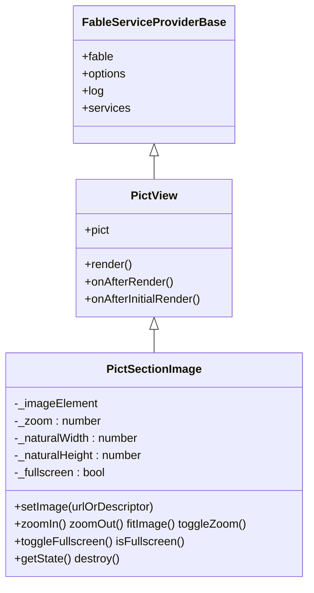
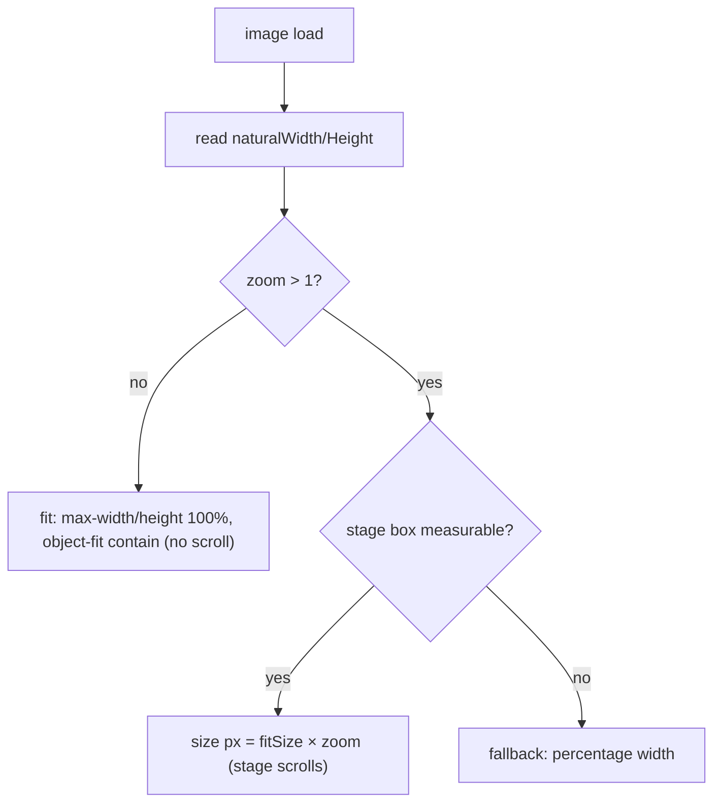

# Architecture

## Overview

`pict-section-image` is a single [`pict-view`](https://fable-retold.github.io/pict-view/) in the lightweight
single-view shape (like `pict-section-code`): a **stub container template**, with the viewer DOM built
**imperatively** in `onAfterInitialRender`. An `` is inherently imperative — its `src`, natural dimensions,
and the `load` / `error` events have no template equivalent — so the toolbar, stage, and image are built once as
real DOM and wired with element-property handlers.

## Class hierarchy

## The zoom model

Zoom is a **multiplier of the fit (contain) size**, not of the natural size:

- `zoom = 1` fits the whole image to the stage (`object-fit: contain`, no scroll).
- `zoom > 1` sizes the image in pixels from the fit size, and the stage scrolls — so panning is native touch- and
  mouse-friendly scroll.

When the natural size and the stage box are measurable (a real browser, after load), the zoomed image is sized in
pixels; when they are not (headless, or pre-layout), it falls back to a percentage width so nothing throws.

## Load, error, and recovery

`setImage()` resets zoom and assigns `src`; the `load` handler records the natural size and presents, while the
`error` handler paints an error panel with a download affordance. Because the error panel replaces the ``
node, a later `setImage()` rebuilds a fresh viewer and recovers. A host re-render that re-stamps the stub over the
built DOM is likewise self-healing — the next `onAfterRender` rebuilds and re-loads the current image, because
instance state (`_url`, `_zoom`, `_fullscreen`) persists.

## Event wiring, fullscreen, and teardown

The toolbar buttons and the `` (load / error / click) use **element-property handlers**, not
`addEventListener` and not template inline handlers — the built-once, programmatic-element exception documented by
`pict-section-code`. Fullscreen is a fill-the-viewport presentation (`.psi-fullscreen`, `position: fixed`) with a
document-level `Escape` handler installed only while maximized. `destroy()` nulls the handlers, removes the `src`,
detaches `Escape`, and clears the target.

## Embedding inside pict-section-fileview

[`pict-section-fileview`](https://fable-retold.github.io/pict-section-fileview/) mounts this view as its
ordinary-image lens with `ShowToolbar: false` — fileview owns the chrome and feeds files through `setImage()`. On
its own, with the toolbar on, it is a complete viewer. Element ids derive from the view's `Hash`, so two viewers
(standalone or embedded) coexist on one page without colliding.
